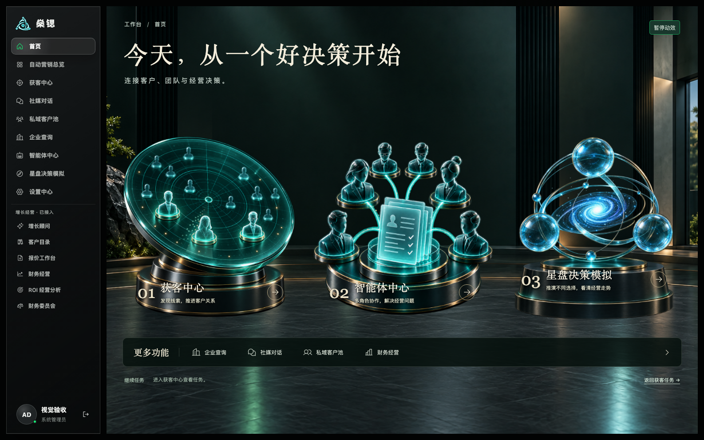
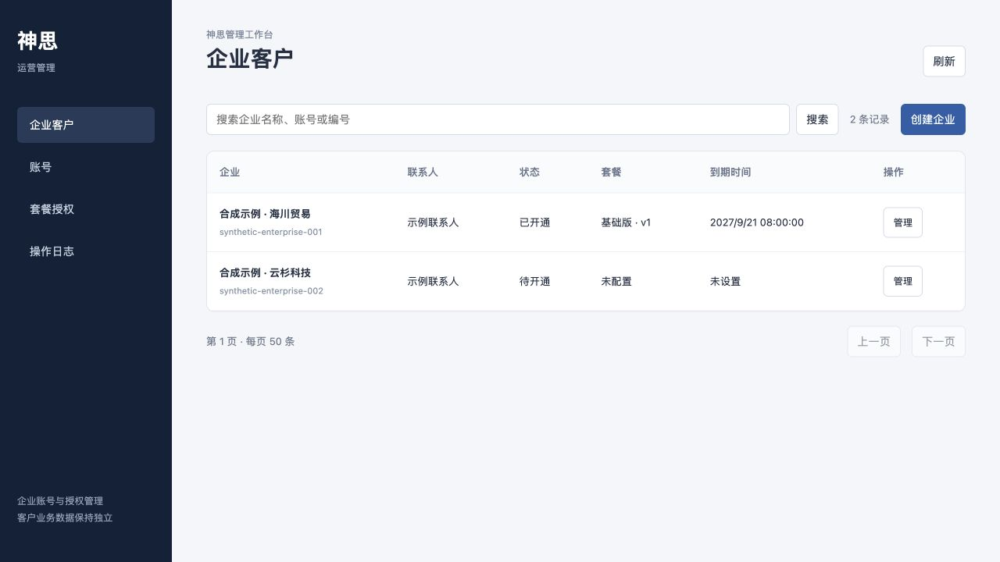
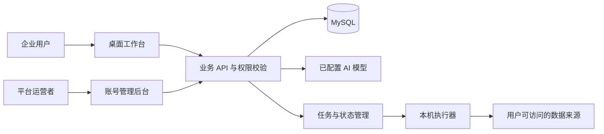

<div align="center">

# Shensi AI · 燊锶

### 连接客户、团队与经营决策

面向在营企业的 AI 工作台：从发现客户，到专业智能体协作，再到经营情景推演与行动复盘。

**获客中心 · 智能体中心 · 星盘决策模拟**

[功能介绍](#核心能力) · [界面预览](#界面预览) · [开始开发](#开始开发) · [架构文档](docs/ARCHITECTURE.md) · [开发进度](docs/PROJECT_STATUS.md)

</div>



> 当前仓库保存最新开发源码。产品包含已实现功能和持续完善中的模块，尚不代表完整生产交付。图片来自正式组件的隔离验收页面，使用合成账号或示例数据，不包含真实客户资料。

## 为谁而做

Shensi AI 帮助已经在经营的企业主与业务团队，把客户线索、企业资料、经营分析和后续行动放在同一套工作流程中。

- **找客户**：从公开业务信息与评论需求中发现候选，核对来源，推进沟通和客户交接。
- **处理经营问题**：让不同专业角色结合企业资料给出有依据的分析。
- **比较决策**：从企业经营基线出发，比较不同方案在需求、成本、回款和交付波动下的表现。
- **留下可复盘的记录**：保留资料来源、模拟假设、分析结果和行动反馈，便于回看与修正。

## 核心能力

### 01 · 获客中心

把发现需求、筛选候选、准备沟通和交接客户组织成连贯流程。

- 关键词驱动的公开评论采集，候选以评论者及需求证据为重点，视频作者作为来源信息保留。
- 本次评论采集数量设置及任务状态展示，支持核对候选的公开来源。
- 社媒评论与私信草稿、人工确认、执行状态和回执管理。
- 候选交接至私域客户池，衔接客户跟进。
- 企业查询支持本机浏览器读取可见企业资料，并提供地区、行业筛选及分页入口。

**能力边界：** 企业查询依赖数据来源的实际收录、登录状态和查看权限，不是自有全国完整企业数据库。外联仍受确认、账号权限和执行条件约束；页面操作不等于平台发送成功。

### 02 · 智能体中心

通过六个专业角色，从不同角度解读企业问题与经营资料。

- 基于已配置模型进行文字问答与资料分析。
- 读取 CSV、XLS、XLSX、文字型 PDF 和 DOCX，结合来源提供分析依据。
- 经营总管支持持久会话历史与实时语音入口；其他角色的能力边界见[角色说明](docs/modules/agent-specialist-skills.md)。
- 与星盘共用经用户确认的经营偏好和已保存报告的建议复盘能力。
- 偏好可查看、修正、关闭、删除及导出，采用反馈前需要明确确认。

**能力边界：** 六个角色不等于全部具备相同的语音与历史恢复能力。当前实时语音和持久文字历史主要接在经营总管；系统不把个人偏好当成企业事实，也不声称已实现自动模型训练。

### 03 · 星盘决策模拟

以企业真实经营起点为基础，结合五角色分析与经营计算，探索不同决策的结果。

**资料 → 核对 → 五角色 → 100 情景 → 报告**，五个步骤可点击回看，已生成内容无需重复分析。

- **企业资料输入**：多文件读取，保留来源，展示缺失或冲突字段，再确认经营基线。
- **五角色协作**：分析目标与约束、需求与渠道、产能与交付、现金与成本，并综合复核。
- **100 条经营路径**：可复现的逐月情景模拟与方案对比，查看现金、利润、订单、交付和回款变化。
- **影响因素解释**：展示因素发生月份、变化幅度与影响路径；已接入需求、采购成本、回款和交付的背景波动，以及首批可选经营事件。
- **直观回放**：情景概览、月份切换、走势查看与星系协作视觉。
- **报告与行动**：保存历史报告，导出包含情景与假设的 HTML 报告，提供依据、实施前提、行动顺序和验收指标明确的降本增效建议。

**能力边界：** 100 条路径是模拟样本，不是 100 家真实企业，样本比例不能直接当作现实成功概率。缺失资料与假设会明确标注；扫描 PDF 的 OCR、更完整的事件库及基于决策风格改变行动轨迹仍在完善。

### 04 · 账号运营后台

独立网页入口，供平台运营者管理企业与授权。

| 页面 | 已实现的首版范围 |
| --- | --- |
| 企业客户 | 企业列表、状态管理、企业主账号创建与授权入口 |
| 账号 | 账号状态操作、停用与恢复、旧会话失效控制 |
| 套餐授权 | 试用版／基础版／专业版，可配置模块、席位和期限 |
| 操作日志 | 管理操作记录与事务审计基础 |

平台成员权限独立于客户业务角色，接入动态验证码、短期运营会话，以及服务端套餐与到期检查。套餐初始为未发布草稿，不自动给已有客户开通权限。

**尚待完善：** 老客户纳管、企业成员创建、一次性密码恢复、运营成员及验证恢复、审计详情与筛选导出，以及正式云环境验收。详见[后台模块文档](docs/modules/platform-administration.md)。

### 其他保留模块

企业查询、社媒对话、私域客户池、增长顾问、客户目录、报价工作台、财务经营、ROI 经营分析和财务委员会均保留，统一通过工作台导航访问。不同模块的导出格式与输入条件以各自文档为准。

## 界面预览

首页采用黑绿与青蓝视觉，以客户雷达、协作装置和星盘区分三个主要入口。插画配合 Canvas 扫描、节点脉冲及光流效果，支持暂停与减少动态效果；它属于 **2.5D 素材与实时装饰层**，不是可自由旋转的实时三维模型。

<details>
<summary><strong>查看账号运营后台</strong></summary>



此图为首版四页后台的隔离布局验收截图，使用合成企业数据。截图早于退出按钮补充，不作为最新所有控件的完整展示。

</details>

星盘分析页保留青蓝星云与角色状态展示。视觉动画用于表达分析阶段，真实进度由任务状态驱动，不使用装饰动画伪造模型完成结果。

## 技术结构

| 层级 | 技术与职责 |
| --- | --- |
| 客户端 | Electron 桌面壳、本机浏览器会话与执行桥 |
| 前端 | TypeScript、Vite，结合现有页面组件与 React 管理页面 |
| 服务端 | Node.js、Express、领域服务与任务 Worker |
| 数据 | MySQL 持久化，按账号／工作区划分业务边界 |
| 契约 | 共享契约、OpenAPI 与类型生成及一致性检查 |
| AI | 已配置模型运行时、角色方法、资料来源与结果校验 |
| 采集适配 | Python Sidecar 与浏览器自动化适配层 |



详见[系统架构](docs/ARCHITECTURE.md)、[接口索引](docs/API_INDEX.md)和[共享智能体能力](docs/modules/shared-agent-capabilities.md)。

## 开始开发

### 环境要求

- Node.js **22.22.3 或更高的 22.x 版本**。
- pnpm **11.18.0**，与仓库 `packageManager` 保持一致。
- 依据所选运行路线准备兼容的 MySQL 和本地容器环境。
- 外部模型与平台凭据由使用者在自己的环境中配置，仓库不附带真实凭据。

### 安装与验证

```bash
git clone https://github.com/kzhangmyang-cmyk/Shensi-ai.git
cd Shensi-ai
pnpm install --frozen-lockfile
pnpm test
pnpm build
pnpm typecheck:desktop
```

私有仓库需要获得访问权限。上述命令用于依赖安装与代码检查，不会自动完成数据库配置或生产部署。

### 选择运行路线

- **桌面源码开发**：先阅读[桌面客户端说明](docs/desktop/macos-electron-client.md)和[部署文档](docs/DEPLOYMENT.md)，核对数据库环境后使用 `pnpm desktop:local`。
- **Web 开发**：按[开发与运行参考](README.development.md)配置本地环境，再使用现有开发脚本。
- **账号后台**：提供独立 `/admin.html`，需要正确的后端和受控平台运营身份初始化，不能直接使用任意客户账号登录。

不要把旧机器上的数据库路径、端口或环境身份直接用于新的开发环境。生产密钥、浏览器登录资料与客户数据应由独立安全渠道提供。

## 部署与迁移

目标是支持境外首发、后续迁至阿里云，程序镜像、数据库、文件与密钥分别管理。桌面端本机浏览器会话不作为云端共享账号。

当前方案优先小规模单实例部署；多副本、无停机发布及正式跨云切换尚不属于已验收能力。云资源、域名、备份恢复、客户端连接和切换回退需在目标环境逐项验证。

- [部署指南](docs/DEPLOYMENT.md)
- [后台上线准备与迁移边界](docs/operations/account-admin-launch-readiness.md)
- [数据迁移说明](docs/DATA_MIGRATION.md)

## 当前状态与验证范围

本仓库首页说明对应 **2026 年 9 月 21 日源码快照**；更细的模块进展以[项目状态](docs/PROJECT_STATUS.md)为准。

- 已完成源码副本的冻结依赖安装、根测试与构建验证。
- 账号后台已通过首批专项测试和隔离 MySQL 事务、持久化及加密备份恢复演练。
- 首页入口、宽窄屏布局及装饰动效已有验收记录。
- 合成数据测试不等于所有真实业务验证，源码构建不等于正式安装包、云部署或收费上线验收。

这个 GitHub 仓库是经过敏感信息排除的源码副本，采用独立提交历史。完整本地备份另行保存；仓库不包含原始客户数据库、模型密钥、浏览器 Cookie、运行日志或本地登录资料。

## 文档导航

| 主题 | 文档 |
| --- | --- |
| 开发与运行参考 | [README.development.md](README.development.md) |
| 当前开发进度 | [PROJECT_STATUS](docs/PROJECT_STATUS.md) |
| 架构与接口 | [ARCHITECTURE](docs/ARCHITECTURE.md) · [API_INDEX](docs/API_INDEX.md) |
| 星盘决策模拟 | [模块说明](docs/modules/decision-simulation.md) · [因素覆盖](docs/modules/decision-factor-catalog.md) |
| 智能体能力 | [角色边界](docs/modules/agent-specialist-skills.md) · [共享能力](docs/modules/shared-agent-capabilities.md) |
| 财务资料读取 | [输入与解析](docs/modules/finance-document-reading.md) |
| 平台后台 | [平台管理](docs/modules/platform-administration.md) |
| 界面验收 | [design-qa](design-qa.md) |
| 素材与第三方来源 | [SOURCE_PROVENANCE](docs/SOURCE_PROVENANCE.md) · [THIRD_PARTY_NOTICES](THIRD_PARTY_NOTICES.md) |

## 许可证与第三方组件

仓库保留的项目许可证见 [LICENSE](LICENSE)。第三方代码、组件和素材遵循各自许可与来源说明；使用或分发时应同时检查第三方声明，不因仓库设为私有而改变其许可要求。
